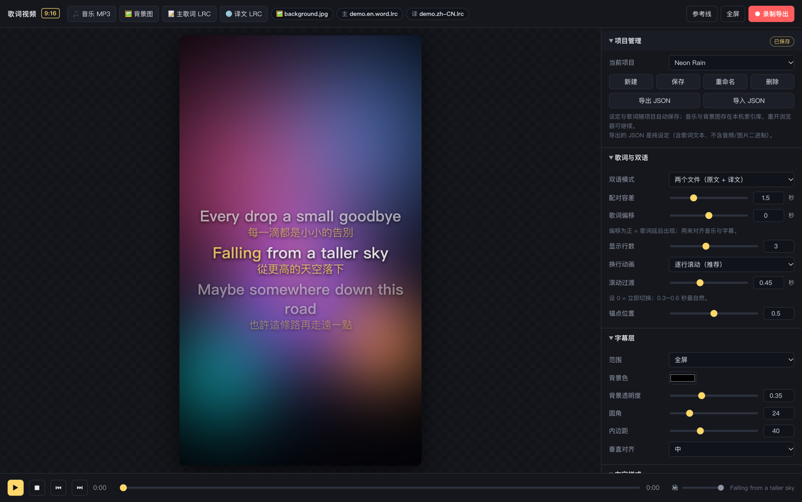

# 🎬 Lyric Video Maker

**A 9:16 bilingual lyric video player and recorder.**
Load a song, a background image and bilingual LRC files, preview karaoke-style subtitles in real time, then record straight to video for social platforms.

> 繁體中文版 → [README.md](README.md)

<br>

<p align="center">
  
</p>

<br>

Pure front-end, zero install — **download and double-click `index.html`**.
Your audio, images and lyrics never leave your machine; everything runs in the browser.

## Why

I write my own English songs and post them to short-video platforms (Douyin / Xiaohongshu). The pipeline looks like this:

```
lyrics → Whisper alignment → LRC → Chinese translation → bilingual lyric video
```

Existing tools are either paid, too rigid about fonts and styling, or clumsy with bilingual subtitles. So I built one: **every parameter exposed, true WYSIWYG, record straight to a video file.**

> The upstream "Whisper lyric alignment workflow" lives in another project (faster-whisper + word-level mapping + QC scripts). This repo covers the last mile: **turning LRC into an uploadable video.**

## Features

### Inputs
- Audio: MP3 / M4A / WAV
- 9:16 background image (cover / contain / stretch, scale, offset, blur, darken)
- Bilingual LRC with **four modes**

| Mode | Use case |
|---|---|
| Two files | Original LRC + translation LRC, matched by nearest timestamp (tolerance adjustable) |
| Single file · adjacent lines | Two consecutive lines sharing a timestamp |
| Single file · inline separator | Original `/` translation in one line, custom separator |
| Main only / translation only | Single-language subtitles |

Drag and drop files straight into the window (audio / image / LRC / font auto-detected).

### Subtitle layer
- **Fullscreen** or **custom region** — drag it on the preview, resize with corner handles, or type exact X / Y / W / H percentages
- Background color + opacity, corner radius, padding
- Type: built-in CJK font list or load your own `.ttf` / `.otf`; separate size and color for original and translation; weight, line height, alignment, stroke, shadow, auto wrap

### Motion
- **Smooth scrolling** (Apple Music style): position, fade and highlight scale all driven by one easing curve, with an adjustable transition duration (0 = instant)
- **Block paging**: show N lines at once, align top / center / bottom
- Current line highlight color + scale, other lines dimmed
- **Word-by-word karaoke**: reads `<mm:ss.xx>` word-level tags (Kugou `.word.lrc` works out of the box), different color for sung / unsung words, with timing fine-tuning

### Export
- MediaRecorder captures canvas + audio; exports **MP4 (H.264)** when supported, WebM otherwise
- 24 / 30 / 60 fps, 4 / 8 / 16 Mbps
- Record from the start or from the current playhead (for chorus-only clips)

### Project management
- **Autosave**: each project is a JSON document in localStorage — settings and lyric text save as you tweak
- Multiple projects: create / switch / rename / delete, so the next song keeps its own look
- Audio and background image persist in a local IndexedDB asset store — close the browser, reopen, everything (even the playhead) is back
- **Export / import JSON**: save a project as a `.lyricproj.json` file (pure settings + lyric text, no audio/image binaries) for backup or moving between machines

### Extras
- Global lyric offset (seconds) to sync subtitles with audio
- Safe-area guides (bottom 22% is covered by platform UI)
- Shortcuts: `Space` play/pause, `←` `→` seek, `⏮` `⏭` previous / next line

## Getting started

```bash
git clone https://github.com/misterlex223/lyric-video-maker.git
cd lyric-video-maker
open index.html          # macOS; `start` on Windows, or drag into Chrome
```

1. Load audio → background → main LRC → translation LRC
2. Tune fonts, subtitle layer and motion in the right panel
3. Hit **● Record**

No media handy? `sample/` ships a pair of bilingual LRC files (including a word-level version) — add any mp3 and you are good to go.

## Supported LRC syntax

```lrc
[ti:Title]
[ar:Artist]
[00:12.34]A line of lyrics
[00:15.00][01:02.00]Repeated chorus line       ← multiple timestamps
[00:37.04]<00:37.04>I<00:37.78>used<00:38.00>to ...   ← word-level tags (karaoke)
```

Encoding is auto-detected (UTF-8 / GBK), BOM included. The parser in `lrc.js` is a standalone pure-function module you can reuse elsewhere.

## Layout

```
lyric-video-maker/
├── index.html      UI and parameter panel
├── style.css       Dark theme
├── lrc.js          LRC parsing + bilingual pairing (pure functions, reusable)
├── app.js          Canvas rendering / playback / region dragging / recording
├── sample/         Sample bilingual LRC
└── assets/         Preview image
```

Everything renders through a single Canvas pipeline (1080×1920), so **preview = recording**: truly WYSIWYG.

> Keep the browser window in the foreground while recording, otherwise frames drop.

## Browser

Chrome / Edge recommended (direct MP4 output, full feature support). Safari works but records WebM.

## License

MIT © 2026 Lex
