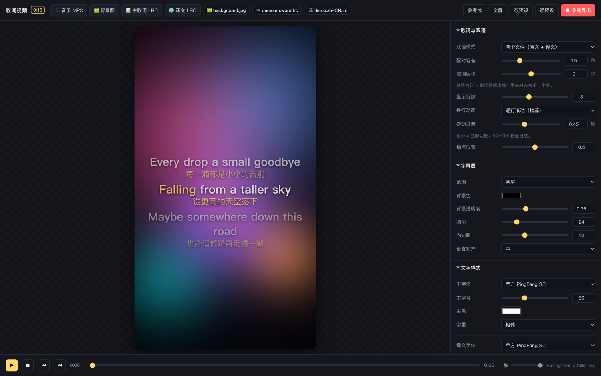

# 🎬 Lyric Video Maker

**9:16 雙語歌詞短影音播放器 + 錄製器。**
載入音樂、背景圖與雙語 LRC，即時預覽卡拉OK字幕效果，一鍵錄製成影片上傳自媒體平台。

> [English version → README.en.md](README.en.md)

<br>

<p align="center">
  
</p>

<br>

純前端、零安裝：**下載後直接雙擊 `index.html`** 就能用。音樂、圖片、歌詞都不上傳任何伺服器，全部在你的瀏覽器裡跑。

## 為什麼做這個

我自己在寫英文歌，想發到抖音／小紅書這類短影音平台。流程是：

```
歌詞 → Whisper 對齊出 LRC → 翻譯成中文 → 做成雙語字幕影片
```

市面上的工具要嘛要錢、要嘛字體樣式不能細調、要嘛雙語支援很陽春。所以自己寫一個：
**參數全開、所見即所得、直接錄成影片**。

> 上游的「Whisper 歌詞對齊工作流」在另一個專案（faster-whisper + 字級映射 + 品檢腳本），
> 這裡專注在最後一哩：**把 LRC 變成能上傳的影片**。

## 功能

### 素材
- 音樂 MP3 / M4A / WAV
- 9:16 背景圖（cover 裁切、contain 完整顯示、拉伸、縮放、位移、模糊、壓暗）
- 雙語 LRC —— **支援四種模式**

| 模式 | 用途 |
|---|---|
| 兩個文件 | 原文 LRC + 譯文 LRC，按時間就近配對（容差可調） |
| 單文件 · 相鄰行合併 | 同一時間戳連續兩行的 LRC |
| 單文件 · 行內分隔符 | 一行內用 `/`、`｜` 分隔原文與譯文 |
| 僅主歌詞 / 僅譯文 | 單語字幕 |

- 檔案可直接拖進視窗（自動識別音訊 / 圖片 / LRC / 字體）

### 字幕層
- **全屏** 或 **指定區域** —— 區域可在畫面上直接拖曳，四角把手縮放，X/Y/寬/高 也能數值精調
- 背景色 + 透明度、圓角、內邊距
- 文字：字體下拉（內建中文字體清單）或載入自己的 `.ttf` / `.otf`；主／譯文字號與顏色分開設定；字重、行距、對齊、描邊、陰影、自動折行

### 動效
- **逐行滾動**：Apple Music 風格平滑滾動，位移／淡化／高亮放大共用同一條緩動曲線，過渡時長可調（0 = 立即切換）
- **整塊翻頁**：一次顯示 N 行，可設上／中／下對齊
- 當前行高亮色 + 放大，其他行淡化
- **逐字卡拉OK**：讀 LRC 裡的字級 `<mm:ss.xx>` 標籤，已唱／未唱分色（酷狗 `.word.lrc` 格式可直接用），逐字時間可微調

### 輸出
- MediaRecorder 錄製：畫面 + 聲音同步寫成影片，瀏覽器支援時直接出 **MP4 (H.264)**，否則 WebM
- 幀率 24/30/60、碼率 4/8/16 Mbps
- 可從頭錄，也可從進度條當前位置錄（只錄高潮片段）

### 其他
- 歌詞偏移微調（秒），用來對齊音樂與字幕
- 樣式預設存／讀（localStorage）
- 安全區參考線（底部 22% 是抖音等平台的 UI 遮擋區）
- 快捷鍵：`空格` 播放暫停、`←` `→` 快退快進、`⏮` `⏭` 上一句下一句

## 快速開始

```bash
git clone https://github.com/misterlex223/lyric-video-maker.git
cd lyric-video-maker
open index.html          # macOS；Windows 用 start，或直接拖進 Chrome
```

1. 載入音樂 → 背景圖 → 主歌詞 LRC → 譯文 LRC
2. 右側面板調字體、字幕層、動效
3. 按「● 錄製導出」

沒有素材也能先試：`sample/` 裡有一組雙語 LRC（含字級版本），配一首自己的 mp3 就能跑完整流程。

## LRC 格式支援

```lrc
[ti:歌名]
[ar:演唱者]
[00:12.34]這是一行歌詞
[00:15.00][01:02.00]重複的副歌            ← 一行多個時間戳
[00:37.04]<00:37.04>I<00:37.78>used<00:38.00>to ...   ← 字級標籤（逐字卡拉OK）
```

- 編碼自動偵測（UTF-8 / GBK），含 BOM 也沒問題
- 解析器 `lrc.js` 是獨立的純函式，可直接拿到別的專案裡用

## 檔案結構

```
lyric-video-maker/
├── index.html      介面與參數面板
├── style.css       暗色 UI
├── lrc.js          LRC 解析 + 雙語配對（純函式，可獨立複用）
├── app.js          Canvas 渲染 / 播放控制 / 區域拖曳 / 錄製
├── sample/         示例雙語 LRC
└── assets/         預覽圖
```

渲染核心是單一一條 Canvas 管線（1080×1920）：**預覽畫面 = 錄製畫面**，所見即所得。
錄製時用 `captureStream` + `AudioContext` 混音，輸出跟你在畫面上看到的完全一致。

> 錄製過程中瀏覽器視窗要保持在前台可見（瀏覽器限制），切到其他分頁會掉幀。

## 瀏覽器

Chrome / Edge 最佳（MP4 直出、完整支援）。Safari 可用，但錄製會輸出 WebM。

## 授權

MIT © 2026 Lex
